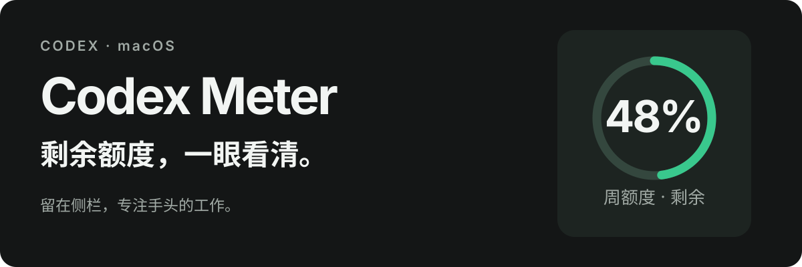

<p align="center">
  
</p>

<p align="center">
  <a href="https://github.com/dongV-x/codex-meter/releases/tag/v0.9.4-dongv.2"><strong>下载 macOS 安装包</strong></a> ·
  <a href="#安装">安装指南</a> ·
  <a href="#常见问题">常见问题</a> ·
  <a href="./LICENSE">MIT License</a>
</p>

# Codex Meter

**把 Codex 剩余额度放在侧栏，工作时一眼就能看到。**

圆环显示的是账号剩余使用额度。鼠标停留或键盘聚焦，可以查看额度窗口和重置时间。上图是界面示意，数值不代表你的当前账号。

## 安装

1. 从 [Releases](https://github.com/dongV-x/codex-meter/releases/tag/v0.9.4-dongv.2) 下载 **`CodexMeter-macOS-0.9.4-dongv.2.zip`**，完整解压。
2. 双击文件夹里的 **`安装.command`**，等待终端提示安装完成。
3. 按 **⌘Q 完全退出 Codex**，再从平时的图标打开，等待约 **5–10 秒**。

圆环会出现在左侧导航栏底部、帮助/账号按钮上方。安装时不会关闭正在工作的窗口。

**需要什么？** macOS、已安装并登录的 Codex，以及可用的客户端内置 CLI。安装器优先使用 Codex 自带的 Node.js 24+，通常无需额外安装 Node，也不需要 `npm install`。包含 Apple Silicon 和 Intel 的原生启动助手；其他设备与后续客户端版本的兼容性尚待验证。

安装包未经 Apple 公证。如果 macOS 阻止打开，可在“系统设置 → 隐私与安全性”中查看是否提供“仍要打开”；请先核对下方校验信息，勿关闭系统级安全保护。

## 看到的就是账号实际返回的额度

| 能力 | 实际表现 |
| --- | --- |
| 额度圆环 | 只有周额度就显示单环；同时返回 5 小时和周额度时显示双环 |
| 重置时间 | 显示北京时间，无需换算时区 |
| 自动刷新 | 每 60 秒读取一次；不可用或过期的数据变灰，不继续冒充最新读数 |
| 当前登录账号 | 使用本机 Codex 登录状态，不需要填密码或 API Key |
| 原图标启动 | 保留常用的打开方式，不额外增加常驻应用图标 |

## 管理与卸载

| 要做什么 | 双击哪个文件 |
| --- | --- |
| 安装或重新安装 | `安装.command` |
| 查看后台与连接状态 | `查看状态.command` |
| 卸载插件 | `卸载.command` |

安装后可以删除下载的压缩包和解压目录。运行文件保存在 `~/Library/Application Support/CodexMeter`，不会修改 Codex 应用包、签名、Dock 或 Launchpad。自动更新保持关闭，新版本请从 Releases 手动下载。

## 常见问题

**安装后暂时没有圆环？**

先确认是 ⌘Q 完全退出，而非只关窗口。重新打开后稍等，再双击 `查看状态.command`。启动助手只对刚启动、尚无用户输入且符合检查条件的客户端尝试一次重开；不要在客户端刚打开时立刻输入。

**显示 `—` 或灰色圆环？**

表示额度暂不可用或读数已经过期，不代表无限额度。确认 Codex 仍已登录、网络正常，稍后等待刷新。API Key 登录或某些套餐可能不提供相同的额度窗口。

**会读取我的项目和聊天吗？**

额度读取路径只调用 Codex app-server 的账号额度接口，不扫描项目或读取聊天内容、会话数据库，也不保存密码、令牌、邮箱或完整账号响应。状态输出可能带本机路径和额度，公开分享前请脱敏。

**兼容性和连接方式有什么限制？**

这是一个非官方 macOS 侧栏扩展，依赖客户端内部界面和本机调试接口。端口固定为 `127.0.0.1:39222`，该接口权限较高，请勿转发到网络。Codex 更新后可能需要重新适配。

<details>
<summary><strong>终端安装、校验与开发</strong></summary>

下载 ZIP 后，可以把它和同一 Release 的 `SHA256SUMS.txt` 放在一起校验：

```sh
shasum -a 256 -c SHA256SUMS.txt
```

从源码安装：

```sh
git clone https://github.com/dongV-x/codex-meter.git
cd codex-meter
npm test
npm run install:local
```

开发者可用 `npm run build:release` 重新生成安装包；产物位于 `dist/`。打包使用 Python 3 标准库，插件运行不需要 Python。

</details>

## License

[MIT](./LICENSE)
